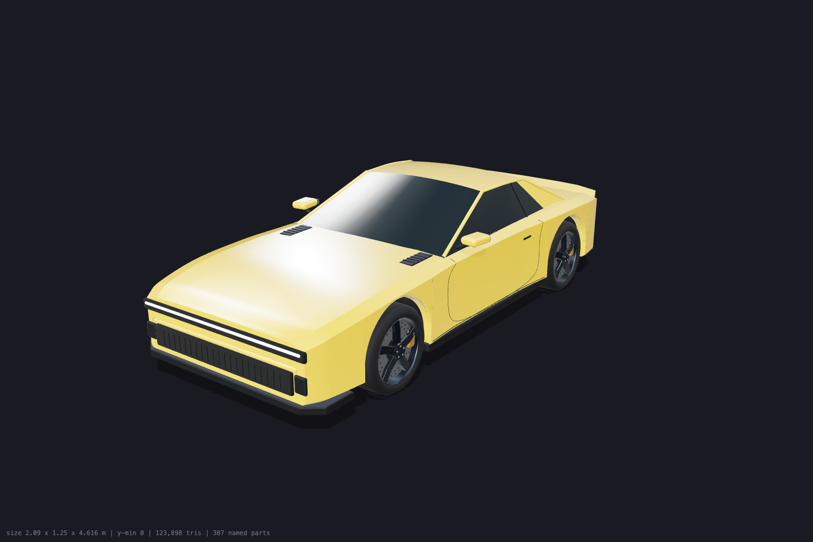
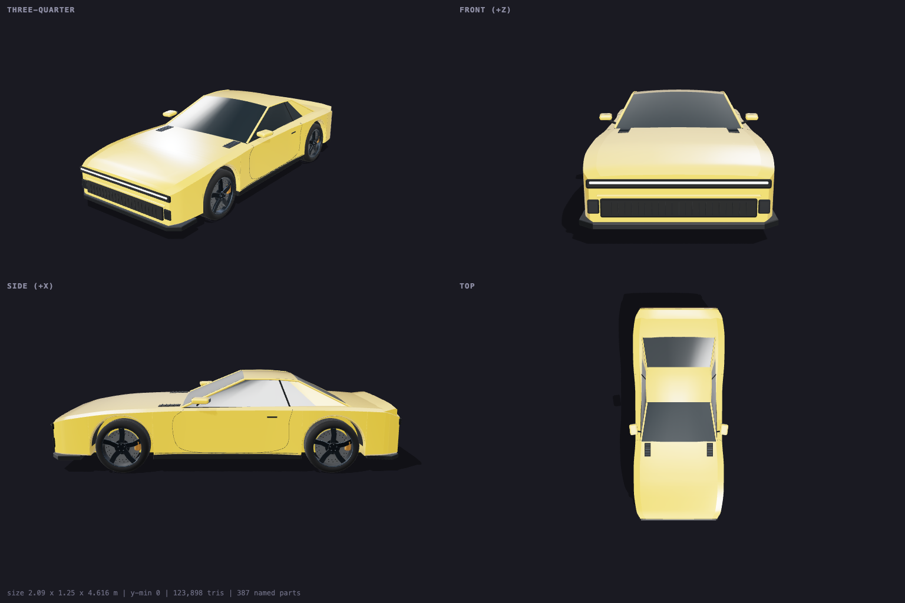
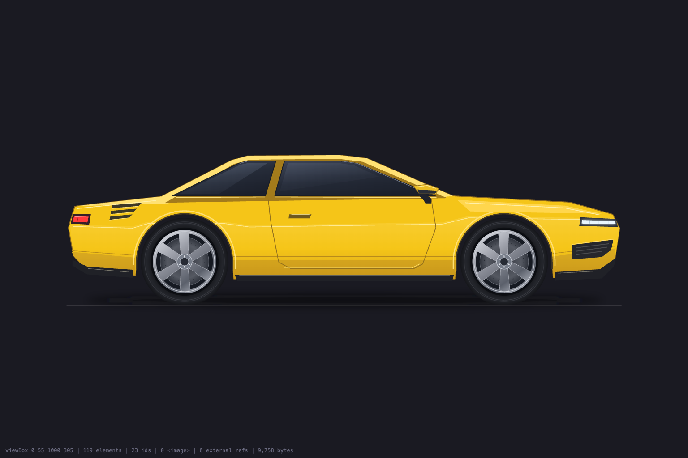
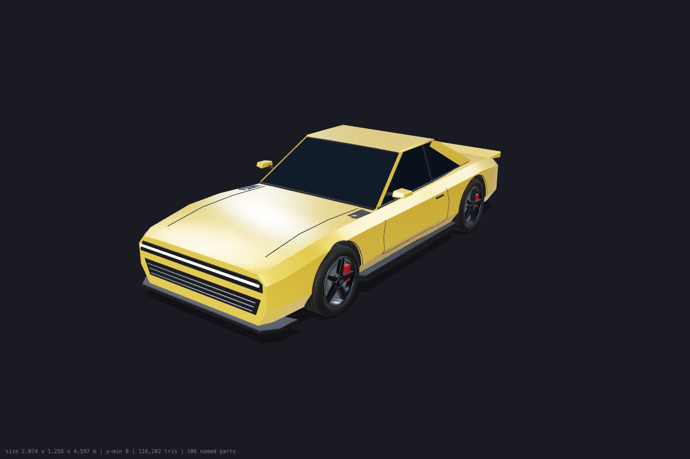
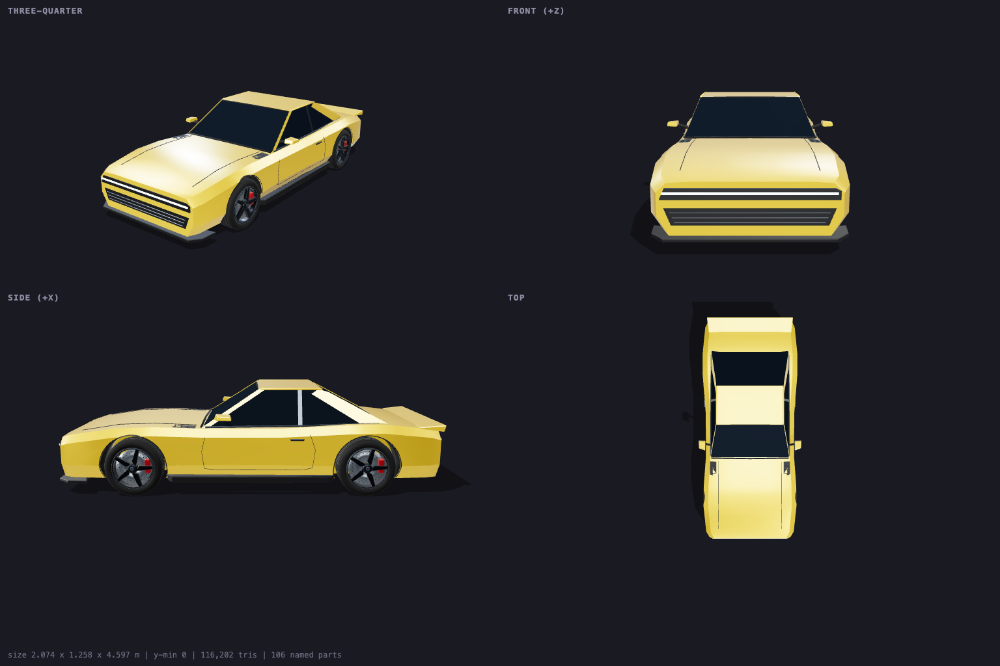

# codex-3d

Claude and GPT-6.1 Sol collaborate on real 3D objects and animatable SVG.
Claude develops the brief and proposed approach, reviews renders independently,
contributes source edits or targeted feedback, and integrates the result. Sol
reasons through the geometry and implements or revises it. Outputs are a
three.js module, a Blender-built GLB with its `.blend` source, or an SVG.

The skill is active again. Every Codex build, revision and optional self-review
uses **`gpt-6.1-sol` at `max` reasoning**, with no fallback. The default is one
build-and-render pass before returning to Claude. Both agents review the actual
artifact against the same brief.

## Model and access

OpenAI released GPT-6.1 Sol on September 29, 2026. Its model ID is
`gpt-6.1-sol`, it accepts image inputs, and it supports `max` reasoning.
OpenAI describes it as offering near-Astra performance for complex work at a
lower cost. This does not establish a 3D-specific quality advantage.
Sources: [model documentation](https://developers.openai.com/api/docs/models/gpt-6.1-sol)
and [release notes](https://developers.openai.com/api/docs/changelog).

Use Codex CLI 0.159.1 or newer; that release added GPT-6.1 Sol to the bundled
model catalog. See the [Codex changelog](https://learn.chatgpt.com/docs/changelog).
An outdated CLI can return a misleading model-not-supported error. Verify the
installed version and model access on your selected account before generating
an asset. A successful model request does not establish 3D output quality.

The wrapper uses the existing Codex login. If the model is reported unsupported,
check `codex --version` before concluding that account access is missing.
An access failure stops the run; the wrapper does not silently substitute
another model or change authentication.

## Examples

These historical examples were built by GPT-6 Astra from the specs in
`examples/*/spec.txt` at `--passes 2 --effort high`. They are preserved as
examples of the output format, not evidence of GPT-6.1 Sol quality or speed.
Nothing was hand-edited; the first two were re-rendered afterwards.

**3D car** (`examples/car/object.js`): 4.6 m long, rests on the ground, ten
exposed parts (`wheel_fl` … `steer_fr`, `body`, `headlights`, `taillight`,
`spoiler`), about 9 minutes.





**2D SVG car** (`examples/car-svg/object.svg`): 9 KB, wheels in their own
pivot groups, about 6 minutes.



**Blender car** (`examples/car-blender/`): the same spec with
`--format blender`, then one `--revise` to darken the glass. 4.6 m long,
58,100 triangles, 106 named nodes including the same ten parts, about 12
minutes plus 3 for the revision. These renders are three.js loading the
exported GLB. The 1.4 MB `object.glb` and 2.7 MB `object.blend` are not in
the repo.





## Install

From the repository root, run `./install.sh` on macOS or Linux, or
`./install.ps1` on Windows. The skill installs into Claude homes only.
Restart running agents to refresh discovery.

Requires Codex CLI 0.159.1+ on `PATH` with an existing login, Node (for the
contract check; `three` is installed into `vendor/` on first use), and
Google Chrome or Chromium for headless renders. `--format blender` also
needs Blender with the [Blender MCP](https://github.com/ahujasid/mcp-for-blender)
add-on enabled, `mcp-for-blender` on `PATH`, and a logged-in graphical
session (the add-on cannot serve from `blender -b`).

## Use

Claude uses this skill for geometry work. Static pictures still use
`codex-image`. A typical first build:

```bash
python3 ~/.claude/skills/codex-3d/scripts/codex_3d.py \
  --out public/3d/car \
  --prompt "Object: one low, wide retro-futuristic muscle sports car
Use: hero object on a dark intro; drifts across the screen, wheels spin and steer
Style: stylised realism, continuous surfaces
Materials: body gloss #F5C518 clearcoat; dark tinted glass; matte black trim; emissive lights
Size: 4.6 m long, 1.95 m wide, 1.25 m tall, wheelbase 2.75 m
Parts to expose: wheel_fl, wheel_fr, wheel_rl, wheel_rr, steer_fl, steer_fr, body, headlights, taillight
Constraints: no text, no logos, symmetric, tyres touch y = 0, under 150k triangles"
```

| Flag | Purpose |
|---|---|
| `--out DIR` | Build folder (**required**). Codex is sandboxed to it |
| `--format three\|svg\|blender` | three.js ES module (default), standalone SVG, or `object.glb` + `object.blend` modelled in Blender |
| `--passes N` | 1 by default: build/revise and render for Claude. 2+ adds Sol self-review |
| `--revise "change"` | Change the existing object; current renders are attached |
| `--render-only` | Re-render after hand edits |
| `--input FILE` | Reference image (repeatable) |
| `--model`, `--effort` | Only `gpt-6.1-sol` and `max` are accepted |
| `--blender PATH` | Blender binary for `--format blender` (or `CODEX_3D_BLENDER`); the MCP server command can be set with `CODEX_3D_BLENDER_MCP` |
| `--json` | Machine-readable result with measured bounds, triangles, parts |

Output in `--out`: `object.js` (or `object.svg`, or `object.glb` +
`object.blend`), `preview.png`, `sheet.png` (2x2 contact sheet, 3D only),
`viewer.html` (orbit viewer), `notes.md` (spec + Sol's reports),
`check.mjs`.

## Working together

Read `notes.md` and inspect `preview.png` plus `sheet.png` before accepting the
asset. Claude can improve the three.js or SVG source and use `--render-only`,
or pass Sol a specific observation and requested correction:

```bash
python3 ~/.claude/skills/codex-3d/scripts/codex_3d.py --out public/3d/car \
  --revise "The front wheels clip the arches at full steering lock. Fix the clearance while preserving the wheelbase, stance, named pivots and body palette."
```

A revision starts a fresh Sol thread with the full output contract, saved
`spec.txt`, current renders and access to previous `notes.md`. It reads the
current source, including Claude's edits. Revisions use one pass by default;
Claude checks the result before the next change. Never edit the same asset
concurrently. Blender contributions go through `--revise` so they stay in the
wrapper's isolated Blender instance.

## The contract

`object.js` is an ES module against `three@0.186.0`:

```js
import * as THREE from 'three';
export function createObject() { /* ... */ return group; }   // THREE.Group, rests on y = 0, centred, faces +Z
export function updateObject(group, t, dt) { /* optional idle animation */ }
export const meta = { name, size: [w, h, d], parts: [...] };
// group.userData.parts = { wheel_fl: mesh, ... }  named, animatable parts
```

Real-world metres, no textures, no external files, no lights or cameras
(the consumer lights it). `check.mjs` enforces the contract and the
triangle budget; Sol runs it before finishing.

`object.svg` is a standalone SVG with a `viewBox`, no raster, and a
`<g id="...">` per part placed on its own pivot with `translate()`.

`object.glb` is a binary glTF exported from `object.blend`. In Blender the
object is Z-up, rests on z = 0 and faces -Y, which the export turns into the
same space as `object.js`: Y up, resting on y = 0, facing +Z. Each named
part is a glTF node with its origin on its pivot, found with
`gltf.scene.getObjectByName('wheel_fl')`. Materials are plain Principled
BSDF values, which export to glTF PBR, and there are no textures. The GLB
carries an idle animation as glTF clips. `node check.mjs object.glb` loads
the file the way three.js will and enforces the same bounds and triangle
budget.

## How it works

1. Copies `viewer.html` and `check.mjs` into the build folder, links
   `three` in for the check, and pipes a contract + your spec to
   `codex exec --json -m gpt-6.1-sol -c 'model_reasoning_effort="max"' -s workspace-write -C <build-dir>`.
   Codex can only write inside that folder.
2. Serves the folder on a throwaway local port and screenshots
   `viewer.html` with headless Chrome (`preview.png`, `sheet.png`). The
   viewer POSTs a status JSON back (bounds, triangle count, part names, or
   the JavaScript error), so a broken module is reported, not guessed at.
   Headless Chrome never exits on a display-less Mac, so the script polls
   for a complete PNG and kills the process group itself.
3. Returns the source, renders and handoff to Claude. When `--passes 2+` is
   requested, resumes the same Sol thread with the renders for self-review
   before the handoff. Every resumed call explicitly pins the model and max
   effort, and nested agent delegation is disabled.

`--format blender` changes only step 1. The script starts a throwaway GUI
Blender with the MCP add-on listening on a free port, and adds `-c`
overrides to `codex exec` that disable every MCP server in the user's Codex
config and register one server, `codex3d_blender`, bound to that port with
eight pre-approved modelling tools (`approval_policy="never"` rejects MCP
calls otherwise). Sol builds with `execute_blender_code`, checks itself
with `get_viewport_screenshot`, saves `object.blend`, exports `object.glb`,
and runs `node check.mjs object.glb`. Steps 2 and 3 then render the exported
GLB in three.js, so the review catches what did not survive the export. The
Blender instance stays up across the review pass and is killed at the end.

The script never uses a Blender the user already has open. On Ali's
machines the launcher named `blender-mcp` is pinned to that shared instance,
so the script resolves `mcp-for-blender` instead and passes it `--port`. The
throwaway scene also carries a marker name that Sol must confirm before it
changes anything. Blender runs outside the Codex sandbox, so these runs turn
on the MCP server's safe mode (`BLENDER_MCP_SAFE_MODE=1`), which limits
Sol's Python to `bpy`, `bmesh`, `mathutils` and pure stdlib imports. The
asset-library tools stay disabled.

Historical Astra timings were about 6 minutes for the SVG car, 9 minutes for
the 3D car and 12 minutes for the Blender car at `--passes 2 --effort high`.
GPT-6.1 Sol at max has not been timed here.
Different objects can run in parallel, Blender builds included, since each
gets its own Blender.

## Layout

```
SKILL.md                    what Claude reads (boundary vs codex-image, workflow)
references/prompting.md     spec recipes, revising, failure fixes
scripts/codex_3d.py         the driver
assets/viewer-three.html    orbit viewer + contact sheet (object.js or object.glb), copied into each build
assets/viewer-svg.html      inline SVG viewer
assets/check.mjs            contract checker
examples/                   verified sample outputs
vendor/                     three@0.186.0 for check.mjs (gitignored, created on first use)
```
